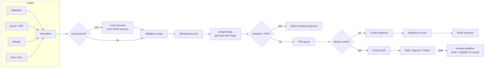
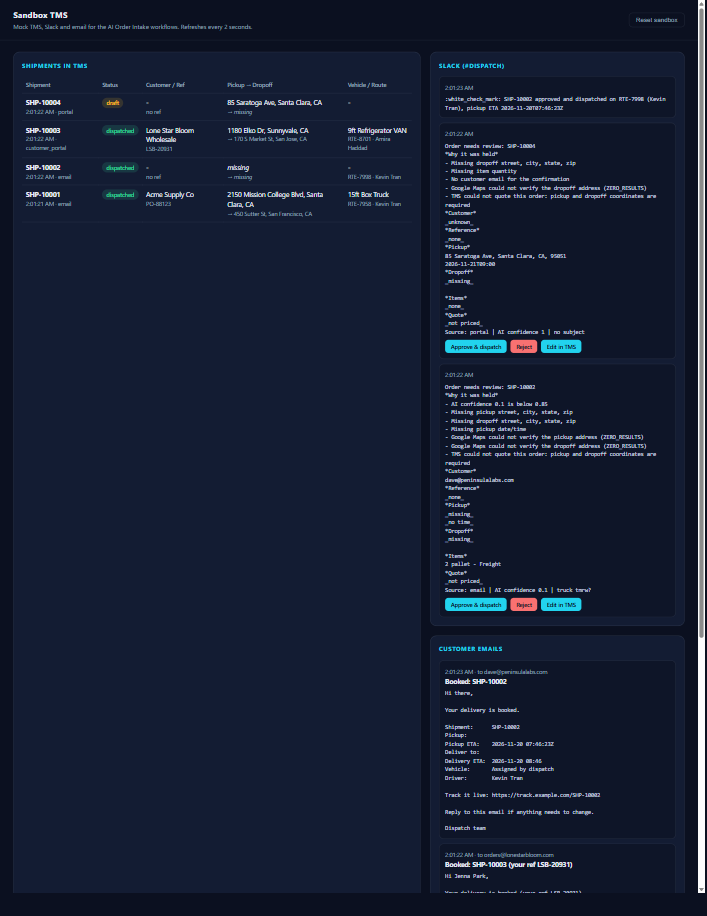

# AI Order Intake → TMS Automation

**n8n · OpenAI · TMS REST API · Slack**

Dispatchers were re-typing B2B orders from emails, PDFs, spreadsheets and store orders into the TMS. Each order took 5–8 minutes, and typos caused failed deliveries.

This project turns every incoming order into a TMS shipment automatically:

- **One intake hub** with webhook, IMAP email (with PDF attachments), Shopify and Google Drive (CSV) triggers
- **An LLM step** that turns unstructured orders into a strict JSON schema, with a confidence score
- **Google Maps address validation**, duplicate detection and automatic quoting from the TMS
- **Shipments created through the TMS API** with idempotency keys, so an order can never be booked twice
- **A Slack approval step:** low-confidence or incomplete orders are saved as drafts and sent to Slack with signed Approve / Reject buttons

Everything runs locally against a built-in sandbox (mock TMS, OpenAI, Google Maps, Slack and SendGrid), so you can demo it without any API keys.

## How it works



An order is **auto-booked** only when all of these are true:

- AI confidence ≥ `AUTO_APPROVE_MIN_CONFIDENCE` (default 0.85)
- Both addresses are complete and Google Maps verifies them precisely (rooftop, no partial match)
- The pickup time is present and not in the past, the windows make sense, and item quantities are known
- The TMS can price it, and the price is ≤ `AUTO_APPROVE_MAX_PRICE` (default $1,500)

Anything else becomes a **draft** in the TMS, and dispatch gets a Slack message listing exactly why it was held.

## What's in this folder

| Path | What it is |
| --- | --- |
| `workflows/` | The three n8n workflows to import (generated, don't edit by hand) |
| `n8n/code/` | JavaScript for every n8n Code node |
| `n8n/build.py` | Builds `workflows/*.json` from `n8n/code` and `schema/` |
| `schema/order.schema.json` | The order JSON schema the LLM must follow |
| `sandbox/` | FastAPI app that mocks the TMS, OpenAI, Google Maps, Slack and SendGrid, plus a live dashboard |
| `samples/` | Test orders: clean email, messy email, structured portal order, CSV |
| `scripts/send-sample.*` | Sends a sample order to the intake webhook |
| `scripts/start-demo.cmd`, `stop-demo.cmd` | Start or stop the whole demo on Windows without Docker |

The three workflows:

1. **AI Order Intake → TMS** (42 nodes): the main pipeline.
2. **Slack Review Actions:** handles the Approve / Reject links. Links are HMAC-signed, expire after 24 hours, and can only act on shipments that are still drafts.
3. **Error Alerts:** any failed execution posts the node, the error and a link to the execution to Slack.

## Quick start (Docker)

```bash
cp .env.example .env
docker compose up --build
```

- n8n: <http://localhost:5678>. Create the owner account on first visit.
- Sandbox dashboard (shipments, Slack messages and emails): <http://localhost:8000>

Send the samples:

```bash
./scripts/send-sample.sh samples/01-email-clean.json      # macOS / Linux
.\scripts\send-sample.ps1 samples\01-email-clean.json     # Windows PowerShell
```

| Sample | What happens |
| --- | --- |
| `01-email-clean.json` | AI extracts everything (confidence 1.0). The order is booked, dispatched, and the customer is emailed. |
| `02-email-messy.json` | "need a truck tomorrow… mission college blvd… the hospital on Sutter". It becomes a draft and goes to Slack with seven reasons. Click **Approve & dispatch** on the dashboard. |
| `03-structured-order.json` | A portal order that skips the AI. It's booked on a refrigerated van. |
| `01-email-clean.json` again | Returns `duplicate` with the existing shipment ID. Nothing new is created. |

After running the samples, the sandbox dashboard shows the shipments in the TMS, the Slack review requests (with the reasons each order was held) and the customer confirmation emails:



Example response for the clean email:

```json
{
  "status": "booked",
  "message": "Booked and dispatched as SHP-10001. Confirmation emailed to maria.lopez@acmesupply.com.",
  "shipment_id": "SHP-10001",
  "route_id": "RTE-7958",
  "driver": "Kevin Tran",
  "pickup_eta": "2026-11-21T09:00",
  "price": 135.6,
  "extraction": { "method": "ai", "confidence": 1, "missing_fields": [] }
}
```

## Running without Docker

You need Node.js 24+ (for n8n 2.x) and Python 3.10+.

**Windows, one click:** install n8n into a folder (`npm install n8n@2.48.6`), then double-click `scripts\start-demo.cmd`, or run it with `-N8nDir <that folder>`. It sets up the sandbox, imports and publishes the workflows on first run, waits until everything is live, and opens the dashboard and the editor. `scripts\stop-demo.cmd` stops everything.

**Manually:**

```bash
python -m venv .venv && .venv/bin/pip install -r sandbox/requirements.txt
.venv/bin/uvicorn app:app --app-dir sandbox --port 8000

npm install -g n8n@2.48.6
n8n import:workflow --separate --input=workflows
n8n publish:workflow --id=aiIntakeAlerts01
n8n publish:workflow --id=aiIntakeReview01
n8n publish:workflow --id=aiIntakeMain0001
```

Export the variables from `.env.example` before `n8n start`, replacing `http://sandbox:8000` with `http://127.0.0.1:8000`. Also set `N8N_BLOCK_ENV_ACCESS_IN_NODE=false` and `N8N_WEBHOOK_URL=http://localhost:5678/`.

## Going to production

1. **Point `.env` at the real services:** OpenAI (or any OpenAI-compatible endpoint), Google Geocoding, a Slack incoming webhook, SendGrid and your TMS. Examples are at the bottom of `.env.example`.
2. **Enable the triggers you need** (Email, Shopify, Google Drive). They're imported disabled. Add credentials in n8n, then enable them.
3. **Map the TMS calls.** The workflow uses five TMS endpoints. Most TMS APIs have equivalents, and only the URL and body of these HTTP nodes need to change:

| Workflow node | Sandbox endpoint | Purpose |
| --- | --- | --- |
| TMS: Find Existing Shipment | `GET /api/v1/shipments?idempotency_key=` | Duplicate check |
| TMS: Get Quote | `POST /api/v1/quotes` | Price + recommended vehicle |
| TMS: Create Shipment / Create Draft | `POST /api/v1/shipments` with an `Idempotency-Key` header | Book or hold the order |
| TMS: Book / Cancel Shipment | `PATCH /api/v1/shipments/{id}` | Reviewer decision |
| TMS: Dispatch to Route | `POST /api/v1/shipments/{id}/dispatch` | Assign route and driver |

4. **Move secrets into n8n credentials** (Header Auth) instead of environment variables if several people edit the workflows.
5. **Tune the thresholds** with `AUTO_APPROVE_MIN_CONFIDENCE` and `AUTO_APPROVE_MAX_PRICE`. Start strict, and loosen them once the review queue shows the AI is reliable for your customers.

## Reliability

- **No double bookings:** a SHA-256 idempotency key from customer, reference, both addresses and the pickup date. It's checked before booking and sent to the TMS as `Idempotency-Key`. Orders missing that data fall back to a hash of the message content.
- **Retries:** network calls retry 3 times with a 2-second wait. The quote call doesn't retry, because a 4xx there is a data problem and goes to review.
- **Nothing fails silently:** unpriceable or unverifiable orders become drafts with reasons attached, and real failures trigger the Slack error alert.
- **Safe approvals:** review links are HMAC-signed with `REVIEW_SIGNING_SECRET`, expire after 24 hours, are compared in constant time, and only work while the shipment is still a draft. A second click shows "Already dispatched".
- **Audit trail:** every shipment carries its source, the intake ID, the AI model and confidence, and a status history in the TMS. Each run is kept in n8n's execution log.

## Editing the workflows

Code node JavaScript lives in `n8n/code/*.js`. After changing it (or `schema/order.schema.json`), rebuild and re-import:

```bash
python n8n/build.py
docker compose run --rm n8n-import
```

## Notes

- The sandbox's `/v1/chat/completions` endpoint uses simple rules, not a model, so demos are repeatable. Set `OPENAI_BASE_URL=https://api.openai.com/v1` and a real key to use GPT. The prompt and schema are already production-ready.
- Slack link buttons work with a plain incoming webhook. To record which dispatcher approved an order, swap the links for a Slack app with interactivity and verify Slack's request signature in the review workflow.
